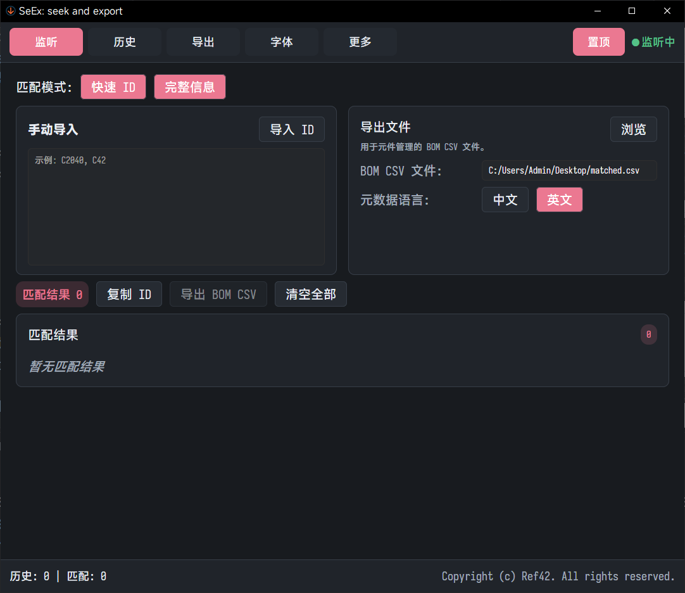
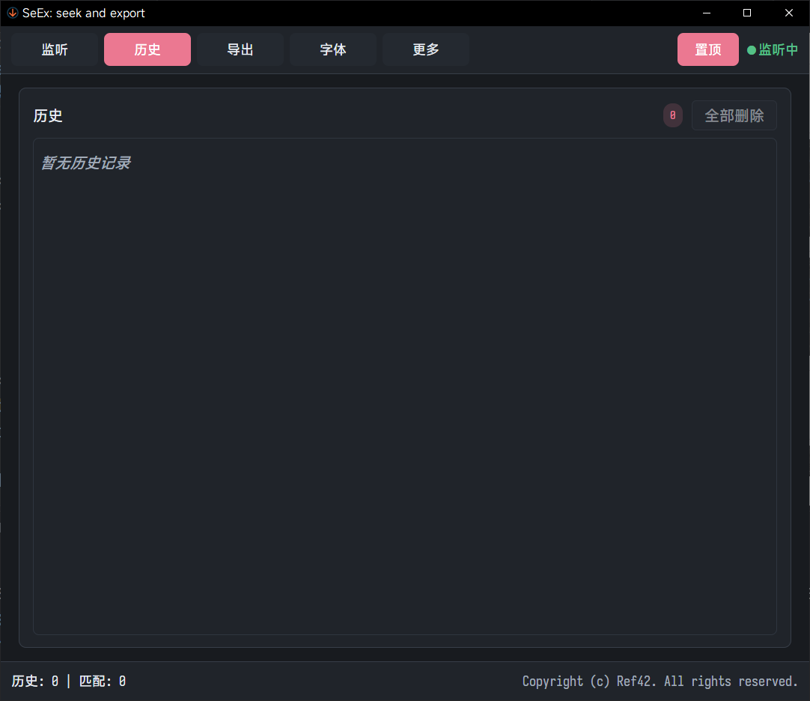
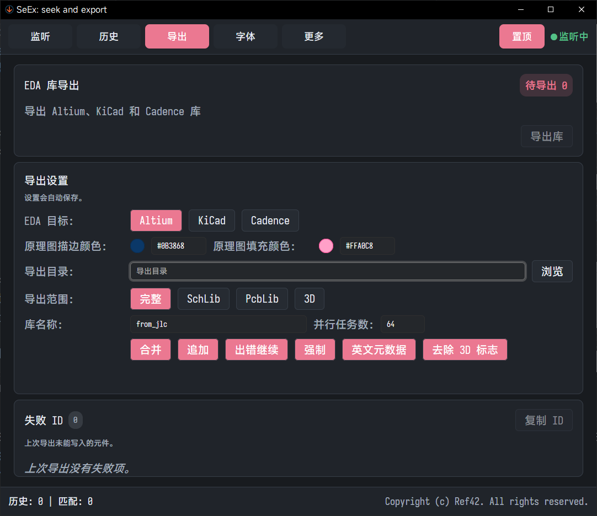
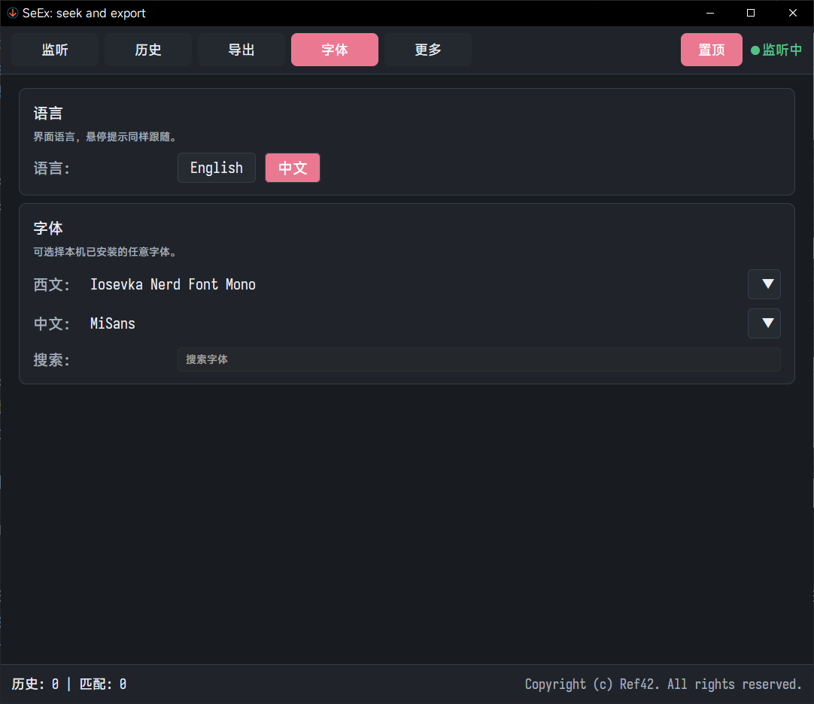
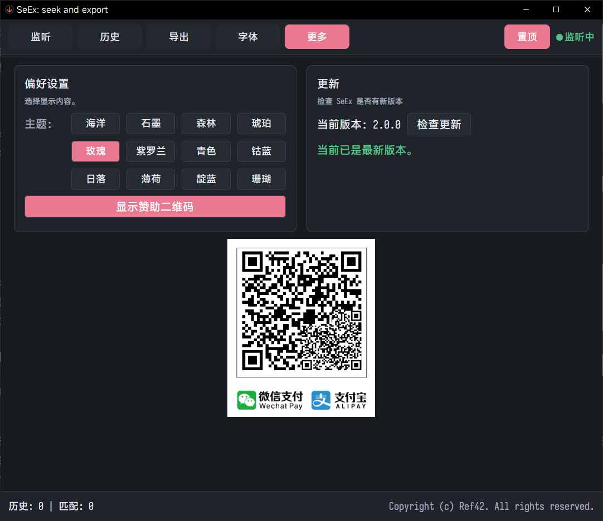

  

<h1 align="center">SeEx(Seek and Export)</h1>

  <strong>批量导出立创商城元件为Altium Designer（AD）、KiCad、Cadence（OrCAD Capture / Allegro）可用的格式。</strong>

<a href="README.en.md">English</a> | <a href="README.md">简体中文</a>

---

## 写在开头
> [!NOTE]
> 项目源码虽已完全公开，但请务必遵循[LICENSE](LICENSE)进行使用。

整个项目的开发历程（按照时间线）：
- 项目伊始，开发了`nlbn（Nice Library Bring now，谐音“拿来吧你”）`，期间曾开源该工具，也获得了不少的star，但却被上传到`Gitee`（垃圾平台，请不要上传我的代码到此处，我认为这个平台污染了我的代码。），遂停止了`nlbn`的维护。我也意识到其实大家根本不看`README`，也不会看`License`文件，对于版权和别人的劳动更是零尊重，特别是当初仅提供了英文版本的`README`，很多人甚至是看不懂的，遂不再维护`nlbn`。😢
- 开发`nlbn`的同时，我也在尝试逆向`Altium Designer`的文件格式，逐渐开发出了`npnp（Normalize Pin Net Pad，谐音“牛批牛批”）`，也尝试了开源，但还是被抄袭。此时开发了相应的`GUI`版本，使用的框架是`tauri2`，虽然制作粗糙，但还是帮不少人解决了问题，我也很开心。😊
- 对应开发的`GUI`工具，也就是现在的`seex（seek and Export）`，一开始是直接调用`npnp`的`cli`进行导出，所以我不得不同时维护两个仓库，时间久了，也觉得累。所以今天进行了重构，`seex`不再依赖`npnp`，而是直接继承了`npnp`的功能，现在用的`GUI`框架是`gpui-kit`（GPUI），`egui/eframe`已经移除。也会持续维护`npnp`，考虑到部分用户有`CI`的需求。😁
- 如果你有想要实现的功能，可以跟我保持联系。我的邮箱是：`lampmud@163.com`/`ybinlew@gmail.com`。你也可以在`issue`里提出。😊
- 请不要再用`python`一类的胶水来重写我的工具了，`python`不是我的`taste`，感谢理解。特别是那种张口闭口`AI`两分钟就写完了的人。🤣
- 项目会长期坚持使用`Rust`开发，如果变更开发语言，最有可能的也只会是`Jai`，虽然它还未发布公开版本。😎
- 此项目还未发布之时，市面上几乎没有此类工具，不知为何最近多了许多相似的项目，这是一件好事，起码大家都有事做。但是这样一个工具实在不值得换一换皮就拿到某平台进行售卖，真的太没品了。基础工具存在的意义就是让每个开发者都能使用，而不是开动脑筋搞经济，真的太没品了。🤣

## SeEx的姐妹项目？？？

- [npnp](https://github.com/ref42/npnp)是`seex`的`cli`版本，更适合`AI`/`Agent`直接调用。
  - 你甚至可以让`AI`帮你分析某个工程，然后调用`npnp`导出所需要的元件。这样就不必再手动搜索挑选器件，只需要核验把关即可。
  - 如果你有待导出元件的客编号，那就更好了，直接喂给`npnp`导出即可。
  - 你也可以将`npnp`作为`CI`工具。

## SeEx现在能做啥？？？
### KiCad部分
- [x] 可以导出KiCad可用的格式，包括`Symbol`, `Footprint`, `3D`模型。
- [x] 可以批量导出以上格式，也可以单独导出。
### Altium Designer（AD）部分
- [x] 可以单独导出器件的`schlib`, `pcblib`（`pcblib`已经内嵌了`step`模型）。
- [x] 也可以批量导出。
- [x] 支持导出多个器件到同一个`schlib`, `pcblib`，即合并导出。
### Cadence（OrCAD Capture / Allegro）部分
- [x] 导出`Capture`原理图符号：一个`Library XML`文件，在`Capture`中通过`File > Import > Library XML`转换为`.olb`。
- [x] 导出`Allegro`封装：每个封装一个`SKILL`脚本，外加一个库脚本；在`Allegro PCB Editor`的命令窗口执行`skill load("<库>_allegro/<库>.il")`，即在同一目录生成`.dra`、`.psm`和`.pad`。
- [x] 导出`3D`模型（`step`），封装中已按立创EDA的位置映射好模型。
- [x] 标准封装（贴片阻容、`SOT`、`SOD`、`SOIC`、`QFN`等）按`IPC-7352`计算焊盘并核对厂家焊盘；其余封装保留厂家焊盘，按`IPC-7352`规则生成丝印、装配层和占位区。
- [x] `seex`本身不调用任何`Cadence`程序，导入由用户在`Cadence`中完成。
### 共同部分
- [x] 均支持选择中英文元数据导出。
- [x] 均支持多线程下载。
- [x] 均支持向已现存的经由`seex`导出的库里添加新的器件/元件。
- [x] 均支持自定义原理图的描边和填充颜色。
- [x] 均支持单独导出`3D`模型。
- [x] 默认去除`3D`模型上的立创EDA标志（水印），重建模型；无法安全去除时保留原模型，并在导出结果中列出这些元件。

## SeEx支持的`EDA`版本？？？
> [!NOTE]
> 这些版本仅为目前所知，不排除`seex`支持更多的版本。如果您无法在更低版本的`EDA`软件中打开`seex`导出的库，可以在`issue`里提出，会考虑适配。
- [x] `KiCad 9.0` ~ `Latest`
- [x] `Altium Designer 23.x` ~ `Latest`
- [x] `Cadence SPB 26.1`（OrCAD X Capture / Allegro X）；`Allegro`封装脚本需要支持`SKILL`的版本（`Allegro PCB Designer`或`OrCAD PCB Designer Professional`）

## SeEx未来想做啥？？？
- [ ] 支持更多的`EDA`工具，类似`pads`等。
- [ ] 继续完善现在的工作流，修复更多隐藏的`bug`。
- [ ] 持续优化交互功能，提升用户使用体验，优化图标，尝试新的设计语言。

## SeEx期待的贡献者？？？
- [x] 具有软件设计经验，能持续维护软件。
- [x] 审美在线，非常期待得到您的宝贵建议。
- [x] “设计师”？？？可以帮助我们重新设计软件的图标，界面Layout等。
- [x] 如果你的`Token`花不完，同时也对本项目感兴趣，大可进行尝试，本项目不排斥使用`AI`，只需确保提交`PR`的时候，所有作者为物理世界存在的活人即可。
- [x] 并不一定需要贡献代码，所有能帮助`seex`和`npnp`变得更好用的建议都会被考虑。并会在文末致谢。

<table>
  
SeEx界面预览

  <table>
    <tr>
      <td></td>
      <td></td>
      <td></td>
    </tr>
    <tr>
      <td></td>
      <td></td>
    </tr>
  </table>
</table>

### 导出示例

<table>
  
KiCad 符号与封装示例

  <table>
    <tr>
      <td></td>
      <td></td>
      <td></td>
    </tr>
    <tr>
      <td></td>
      <td></td>
      <td></td>
    </tr>
  </table>
</table>

<table>
  
KiCad 3D 模型示例

  <table>
    <tr>
      <td></td>
      <td></td>
      <td></td>
    </tr>
    <tr>
      <td></td>
      <td></td>
      <td></td>
    </tr>
  </table>
</table>

<table>
  
Altium SCH+3D 模型库示例

  <table>
    <tr>
      <td></td>
      <td></td>
      <td></td>
    </tr>
    <tr>
      <td></td>
      <td></td>
      <td></td>
    </tr>
  </table>
</table>

<table>
  
Altium PCB 示例

  <table>
    <tr>
      <td></td>
      <td></td>
      <td></td>
    </tr>
    <tr>
      <td></td>
      <td></td>
      <td></td>
    </tr>
  </table>
</table>

## 参考和致谢

以下排名不分先后，仅按照软件开发时的时间线进行排序。

### 参考

- [`easyeda2kicad`](https://github.com/uPesy/easyeda2kicad.py)@[uPesy](https://github.com/uPesy)
  - 虽然只支持`kciad`，但也给了我一部分灵感，这是一个很优秀的工具，市面上`KiCad`相关的`easyeda`导入插件，绝大多数都是在这个工具的基础上进行开发的。
- `IPC-7352(2023)`https://dokumen.pub/qdownload/ipc-7352-generic-guideline-for-land-pattern-design.html.
  - 用于`3D`模型重建。

### 致谢

- 菊猫大佬
  - 赠送给我一部分`TOKEN`，虽然也自费购买了一部分，但是最后算下来也属于半买半送了，那个时候`opus 4.6`还很好用，猛蹬`opus 4.6`，实现了很多功能，打下了好的基础。
- `emoji`老弟@[z217-cpu](https://github.com/z217-cpu)
  - 帮忙测试了多平台兼容性，从项目伊始直至现在都一直在帮我测试，非常感谢！
- `🐏🐏`@[Cloud-Lightning](https://github.com/Cloud-Lightning)
  - 曾在多个项目里使用`seex`，并且给了我非常多的实用建议，非常感谢！
- ` c大佬`@[lins-code54](https://github.com/lins-code54)  
  - 为软件提供了导出`Cadence`的支持；同时还提供了`3D`模型的重建功能，`3D`模型不再附带云纹或者文字`Logo`；非常感谢！
- 微信`1`群和`2`群的所有群友
  - 并没有反感我在该群里发布`seex`和`npnp`的更新事宜，相反却十分捧场，非常感谢！
- 所有用户
  - 如果没有你们的下载与`star`，可能这个项目会被我搁置，非常感谢！