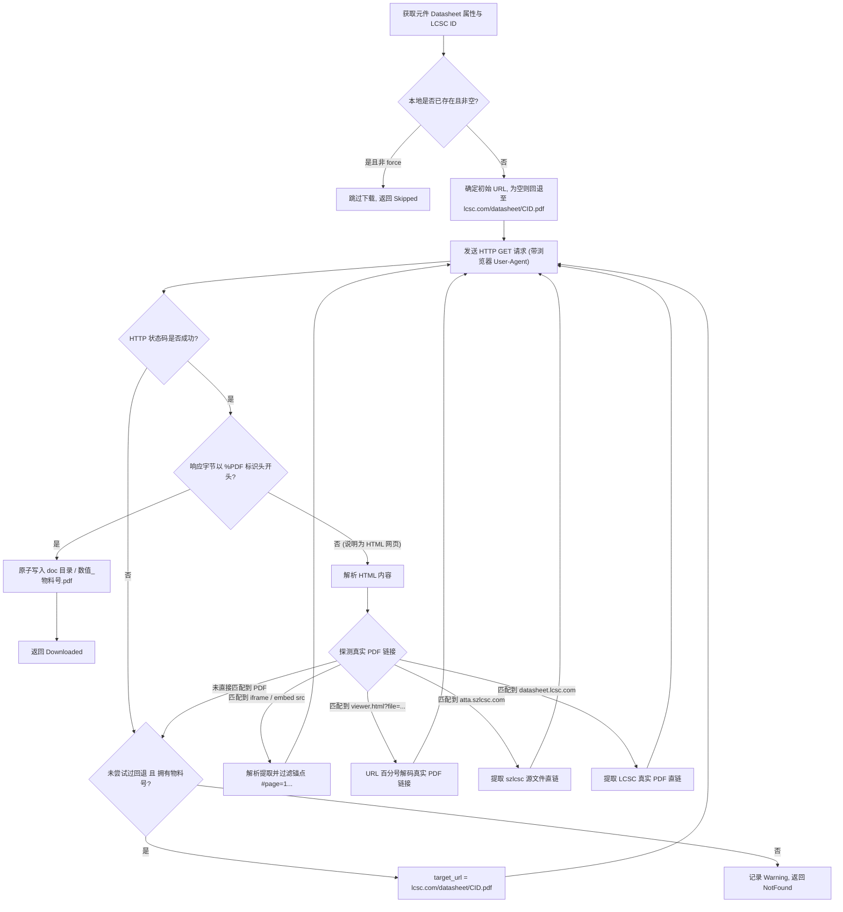

# SeEx 库下载程序新增功能实现原理

本文档详细记录 `seex` 针对嘉立创（JLC/LCSC）元器件库导出程序新增的三项核心功能的实现原理、架构设计、代码改动及编译运行方法。

---

## 目录
1. [功能一：同封装及其 3D 模型去后缀原生导出](#功能一同封装及其-3d-模型去后缀原生导出)
   - [1.1 需求背景](#11-需求背景)
   - [1.2 命名还原算法与规格转换](#12-命名还原算法与规格转换)
   - [1.3 封装导出处理流程（Footprint Converter）](#13-封装导出处理流程footprint-converter)
   - [1.4 3D STEP 模型导出处理（Model Converter）](#14-3d-step-模型导出处理model-converter)
2. [功能二：符号库“数据手册”PDF 本地自动化下载](#功能二符号库数据手册pdf-本地自动化下载)
   - [2.1 需求背景与文件组织](#21-需求背景与文件组织)
   - [2.2 多层级链接解析与探测链路（Resolution Pipeline）](#22-多层级链接解析与探测链路resolution-pipeline)
   - [2.3 防错与真实性校验机制](#23-防错与真实性校验机制)
   - [2.4 网络客户端与并发优化](#24-网络客户端与并发优化)
3. [功能三：GUI 导出设置选项增强（PDF / 物料后缀 / 小数点转换）](#功能三gui-导出设置选项增强pdf--物料后缀--小数点转换)
   - [3.1 需求背景与控制选项](#31-需求背景与控制选项)
   - [3.2 详细选项机制与行为规范](#32-详细选项机制与行为规范)
   - [3.3 配置自动持久化（ExportConfig）](#33-配置自动持久化exportconfig)
4. [整体代码架构与改动清单](#整体代码架构与改动清单)
5. [编译与运行方法](#编译与运行方法)
   - [5.1 环境准备](#51-环境准备)
   - [5.2 测试与验证命令](#52-测试与验证命令)
   - [5.3 编译发布版本](#53-编译发布版本)
   - [5.4 运行与使用方法（CLI / GUI）](#54-运行与使用方法cli--gui)
6. [测试用例与验证覆盖](#测试用例与验证覆盖)

---

## 功能一：同封装及其 3D 模型去后缀原生导出

### 1.1 需求背景
嘉立创网络 API 导出的封装和 3D 模型文件名默认带有 `_C<id>` 物料编号后缀（例如 `XT30PW-M_C431092.kicad_mod` 和 `CONN-TH_XT30PW-M_C431092.step`）。
在实际硬件工程中，同一种标准封装（如 `XT30PW-M`、`0603` 阻容）应复用同一份无物料后缀的干净封装和 3D 模型，避免库中冗余堆积大量带特定批次物料号的重复模型。
此前该功能由独立的 Python 脚本（`restore_step_models.py`）后处理完成，现已原生内置于 `seex` 的 KiCad 导出管线中。

### 1.2 命名还原算法与规格转换
核心算法实现在 [`src/kicad/converter.rs`](src/kicad/converter.rs) 中：

1. **物料编号后缀剥离**：
   - 匹配尾部的 `_C\d+$`（忽略大小写）并剥离。
   - 示例：`XT30PW-M_C431092` $\rightarrow$ `XT30PW-M`。
2. **尺寸规格下划线恢复小数点**：
   - EDA 上游命名常将小数点替换为下划线（例如 `L1_6-W0_8-H0_8` 实为 `L1.6-W0.8-H0.8`）。
   - 通过正则匹配前后均为数字的下划线：`(\d)_(\d)`，替换为 `${1}.${2}`。
   - 示例：`C0603_L1_6-W0_8-H0_8_C999` $\rightarrow$ `C0603_L1.6-W0.8-H0.8`。
3. **3D STEP 模型命名对应**：
   - 保留 3D 模型的功能分类前缀（如 `CONN-TH_`、`RES-SMD_`），只对型号核心与后缀部分做相同剥离，得到与干净封装匹配的 `CONN-TH_XT30PW-M.step`。

### 1.3 封装导出处理流程（Footprint Converter）
实现于 [`src/kicad/footprint_converter.rs`](src/kicad/footprint_converter.rs)：

```
API 获取原始封装数据
        │
        ├─► 1. 导出带物料后缀的原始封装: {Name}_{C_ID}.kicad_mod
        │      (内部 3D 模型指向: {Model}_{C_ID}.step)
        │
        └─► 2. 生成并导出无后缀干净封装: {Clean_Name}.kicad_mod
               ├─ 替换内部 S 表达式 footprint 名称为 Clean_Name
               ├─ 替换 value 文本字段为 Clean_Name
               ├─ 替换内部 3D 模型引用路径为 Clean_Model.step
               └─ 使用 write_footprint_if_needed(overwrite: false)
                  (若同名干净封装已存在，直接安全跳过，确保只保存一次)
```

- **S 表达式转换保证**：
  使用精确正则匹配封装头 `(footprint "{old_name}")` 和值字段 `(property "Value" "{old_name}" ...)` 进行原地替换，保证导出的 KiCad v6 封装语法合规。
- **唯一性与防重复覆盖**：
  设置 `overwrite: false`，同一工程中即使导入 10 颗不同物料但封装同为 `0603` 的阻容，无后缀的 `0603.kicad_mod` 仅在首次生成时写入磁盘，后续批次自动复用。

### 1.4 3D STEP 模型导出处理（Model Converter）
实现于 [`src/kicad/model_converter.rs`](src/kicad/model_converter.rs)：

1. API 下载 STEP 模型字节流并经由 `step_sanitizer` 去除杂乱丝印/覆盖层。
2. 写入原始带后缀模型文件：`<lib_name>.3dshapes/{model_name}.step`。
3. 计算还原出的无后缀文件名 `clean_model_name`。
4. 若 `clean_model_name != model_name` 且本地尚未存在该 clean 模型文件：
   - 直接复用内存中已过滤好的模型二进制数据写入磁盘；
   - 记录 `clean_model_name` 已写入状态，避免后续物料重复 IO 写入。

---

## 功能二：符号库“数据手册”PDF 本地自动化下载

### 2.1 需求背景与文件组织
符号库 `murmur.kicad_sym` 中的每一个元器件符号均包含 `(property "Datasheet" "...")` 属性。
为方便离线查阅与库归档，系统自动将数据手册真实 PDF 文件下载到本地专门的数据手册库目录：
- **目录规范**：`<output_path>/<lib_name>.doc/`（例如 `murmur.doc/`），与 `<lib_name>.pretty/`、`<lib_name>.3dshapes/` 及 `<lib_name>.kicad_sym` 保持完全平级。
- **命名规范**：`“数值”+“物料号”.pdf`，即 `{Value}_{C_ID}.pdf`（例如 `DON70N03_C48542676.pdf`、`1N4148W-TP_C77978.pdf`），与符号库内符号对象名 `(symbol "DON70N03_C48542676" ...)` **完全一致**。

### 2.2 多层级链接解析与探测链路（Resolution Pipeline）
上游返回的数据手册链接形式多样，实现模块 [`src/kicad/datasheet.rs`](src/kicad/datasheet.rs) 构建了多跳探测引擎（最多 4 次自动重定向与 DOM 内嵌解析）：



#### 各类型链接解析策略：
1. **直接 PDF 链接**：
   - 如 `https://example.com/datasheet.pdf`。
   - 读取前 4 字节魔数判定是否为 `b"%PDF"`，确认直接写入。
2. **嘉立创官方预览器（szlcsc Viewer）**：
   - 典型 URL：`https://item.szlcsc.com/datasheet/DON70N03/50802276.html`。
   - 特征：响应为 HTML，内嵌 `<iframe src="https://atta.szlcsc.com/upload/public/pdf/source/xxx.pdf#page=1&view=fitH">`。
   - 处理：正则提取 `src` 并剥离 `#...` 片段锚点，下一跳请求真实 PDF 直链。
3. **PDF.js Web 预览器参数**：
   - 特征：`<iframe src="/pdfjs/web/viewer.html?file=https%3A%2F%2Fatta.szlcsc.com%2F...pdf">`。
   - 处理：解析查询参数 `file`，执行自实现的 `percent_decode` 还原为标准 URL。
4. **立创商城产品详情页（Product Detail Page）**：
   - 典型 URL：`https://www.lcsc.com/product-detail/Switching-Diode_MCC_1N4148W-TP_1N4148W-TP_C77978.html`。
   - 特征：HTML 包含指向 `https://www.lcsc.com/datasheet/C77978.pdf` 或 `https://datasheet.lcsc.com/...` 的下载锚点。
   - 处理：提取并追踪链接。
5. **立创商城手册嵌入页（LCSC Datasheet Page）**：
   - 典型 URL：`https://www.lcsc.com/datasheet/C77978.pdf`（扩展名为 `.pdf`，但实为封装了 iframe 的 HTML 网页）。
   - 特征：HTML 内包含 `<iframe src="https://datasheet.lcsc.com/datasheet/pdf/<hash>.pdf?productCode=C77978">`。
   - 处理：多跳循环第二跳解析出该 iframe 地址，第三跳请求获得真正的 `%PDF` 二进制流。

### 2.3 防错与真实性校验机制
- **`%PDF` 魔数强制校验**：
  任何下载的响应数据在落盘前必须检查 `bytes.starts_with(b"%PDF")`。严防将 HTML 404 页面或防爬验证页保存为 `.pdf` 损坏文件。
- **原子安全写入（Atomic Write）**：
  先写入临时文件 `.tmp`，刷写完成后原子重命名为正式 `.pdf` 文件，防止下载中断产生坏损残卷。
- **故障隔离设计**：
  当某个元器件因停产/下架导致官方无可用数据手册时，仅通过 `log::warn!` 输出提示信息，不阻断、不影响 KiCad 原理图符号与封装库的正常导出。

### 2.4 网络客户端与并发优化
- **专用浏览器标识**：
  `datasheet_client()` 全局单例持有配置了标准 Chrome 120 浏览器 User-Agent 的 `reqwest::Client`，规避立创/阿里 CDN WAF 对脚本默认 User-Agent 的拦截。
- **连接池复用**：
  支持多元件批量并发导出时复用长连接（Keep-Alive），大幅缩短批量抓取耗时。

---

## 功能三：GUI 导出设置选项增强（PDF / 物料后缀 / 小数点转换）

### 3.1 需求背景与控制选项
为满足不同硬件工程团队对元件库规范的个性化需求（例如：部分用户无需离线数据手册以节约磁盘与带宽；部分用户不需要在库文件名中携带特定批次物料编号；部分用户或 EDA/CAM 工具要求尺寸规格中的小数点全部替换为下划线以防解析异常），在 GUI 界面的 **Export Settings（导出设置）** 面板中新增了 3 项交互切换开关（Toggle Button），并支持随软件自动持久化保存：

- **下载PDF (`Download PDF`)**：控制是否下载数据手册 PDF 文件；
- **添加物料后缀 (`Add Suffix`)**：控制是否为导出的库文件添加 `_C<id>` 物料编号后缀；
- **替换小数点.为下划线_ (`Replace . with _`)**：控制尺寸数值与命名中小数点 `.` 到下划线 `_` 的替换转换。

### 3.2 详细选项机制与行为规范

| 选项名称 (中/英) | 默认值 | 启用状态行为 (True) | 关闭状态行为 (False) | 影响管线范围 |
|---|---|---|---|---|
| **下载PDF**<br>`Download PDF` | `true` | 在符号库导出阶段，自动探测并下载对应元器件真实 `%PDF` 数据手册至 `<lib_name>.doc/` 目录 | 完全跳过 PDF 探测与网络下载，不创建冗余 `.doc` 目录，大幅加速批量导出耗时 | KiCad Workflow、数据手册下载管线 |
| **添加物料后缀**<br>`Add part suffix` | `true` | 导出的封装、3D 模型、原理图符号与数据手册均携带立创物料后缀（如 `XT30PW-M_C431092`），同时辅助生成干净无后缀模型 | **仅生成无后缀的干净封装与 3D 模型**（如 `XT30PW-M.kicad_mod` 和 `CONN-TH_XT30PW-M.step`）；符号名称与 `Footprint` 属性直接绑定干净封装名，避免库文件冗余 | Footprint、Model、Symbol、Datasheet 命名与导出 |
| **替换小数点.为下划线_**<br>`Replace . with _` | `false` | 将元器件命名与尺寸中的小数点 `.` 转换为下划线 `_`（例如 `L1.6-W0.8` $\rightarrow$ `L1_6-W0_8`、`2.54mm` $\rightarrow$ `2_54mm`），适应特殊 CAD/CAM 语法要求 | **保留标准小数点 `.`**，并将上游 EDA 导出的尺寸数字间下划线智能还原为标准小数点（例如 `L1_6-W0_8` $\rightarrow$ `L1.6-W0.8`） | 命名清洗还原算法、封装与 3D 模型命名 |

### 3.3 配置自动持久化（ExportConfig）
- 界面操作变动实时通过 `MonitorState` 的 `set_export_download_pdf()`、`set_export_add_suffix()` 和 `set_export_replace_dot()` 进行响应。
- 配置变更即时触发 `save_config()` 自动持久化写入操作系统用户目录下的 `export_config.json`（带有 `#[serde(default)]` 机制，保证升级向后兼容）。
- 软件重启后无缝加载恢复历史设置。

---

## 整体代码架构与改动清单

| 模块文件 | 关键职责与修改 |
|---|---|
| [`src/main.rs`](src/main.rs) | GUI Export Settings 面板增加“下载PDF”、“添加物料后缀”、“替换小数点.为下划线_”三大开关，处理配置加载与快照持久化 |
| [`src/config.rs`](src/config.rs) | `ExportConfig` 结构体新增 `download_pdf`、`add_suffix`、`replace_dot` 字段及默认值定义 |
| [`src/monitor.rs`](src/monitor.rs) | `MonitorState` 增加对应配置的状态字段及 setter 方法 |
| [`src/kicad/converter.rs`](src/kicad/converter.rs) | `sanitize_name`、`restore_footprint_name`、`restore_step_model_name` 支持 `replace_dot` 切换；新增 `make_suffixed_name` 与 `make_suffixed_model_name` 命名构造器 |
| [`src/kicad/footprint_converter.rs`](src/kicad/footprint_converter.rs) | 封装导出及 3D 模型引用路径适配 `add_suffix` 与 `replace_dot`；当 `add_suffix: false` 时仅输出干净封装 |
| [`src/kicad/model_converter.rs`](src/kicad/model_converter.rs) | 3D STEP 模型导出适配 `add_suffix` 与 `replace_dot`；当 `add_suffix: false` 时仅输出标准命名 STEP 模型，节约下载流量 |
| [`src/kicad/symbol_converter.rs`](src/kicad/symbol_converter.rs) | 原理图符号名称与 `Footprint` 属性绑定根据 `add_suffix` 自动对齐带后缀或干净封装名称 |
| [`src/kicad/datasheet.rs`](src/kicad/datasheet.rs) | **【新增模块】** 数据手册探测引擎、iframe 解析、百分号解码、`%PDF` 校验及下载管线 |
| [`src/kicad/library.rs`](src/kicad/library.rs) | `LibraryManager` 增加 `doc_lib_dir` 目录管理（`<lib_name>.doc`）、`get_doc_path` 与 `write_doc_file` 原子写 |
| [`src/kicad/workflow.rs`](src/kicad/workflow.rs) | KiCad 批量导出管线整合：根据 `download_pdf` 开关决定是否触发手册抓取，并在 `KicadBatchSummary` 中记录数据手册统计计数 |
| [`src/kicad/options.rs`](src/kicad/options.rs) | `KicadExportOptions` 新增 `download_pdf`、`add_suffix`、`replace_dot` 字段与默认值实现；`KicadLibraryOptions` 新增 `doc_lib` |
| [`src/cli.rs`](src/cli.rs) | `KicadCommands::Export` 与 `Batch` 增加 `--doc-lib` 选项支持 |
| [`src/exporter.rs`](src/exporter.rs) | `ExportRequest` 传递新选项，GUI 导出汇总信息展示新增 `Datasheets` 计数与配置状态展示 |

---

## 编译与运行方法

### 5.1 环境准备
- **Rust 工具链**：支持 Rust 2024 edition（建议使用最新 stable 或 nightly 版本）。
- 确认命令可用：
  ```bash
  rustc --version
  cargo --version
  ```

### 5.2 测试与验证命令
在 `seex` 项目根目录下执行测试：
```bash
# 1. 运行语法检查与代码分析
cargo check

# 2. 运行完整测试套件（共 139 个测试用例，包含单元测试与网络端到端测试）
cargo test --bin seex

# 3. 运行特定模块测试：
# 仅测试数据手册下载与链接探测引擎
cargo test --bin seex kicad::datasheet::tests

# 仅测试封装与 3D 模型去后缀还原
cargo test --bin seex kicad::converter::tests

# 仅测试 KiCad 全流程批量导出
cargo test --bin seex kicad::workflow::tests::test_export_kicad_batch_with_datasheet_and_clean_names
```

### 5.3 编译发布版本

#### 方式一：一键脚本编译（推荐）
直接双击运行工程目录下的 `build.bat` 脚本，脚本将自动检测 Rust 工具链完成优化编译，并支持编译完成后一键启动：
```bash
build.bat
```

#### 方式二：命令行手动编译
编译优化并去除调试符号的 Release 二进制可执行文件：
```bash
cargo build --release --bin seex
```
编译产物位于：
- **Windows**：`target/release/seex.exe`

### 5.4 运行与使用方法（CLI / GUI）

#### A. 命令行方式（CLI）
通过命令行可以直接单颗或批量抓取下载：

1. **单颗元件导出**（以 DON70N03 / C48542676 为例）：
   ```bash
   cargo run --release --bin seex -- kicad export C48542676 --full -o ../export --library-name murmur
   ```
   或者直接运行编译好的可执行程序：
   ```bash
   ./target/release/seex.exe kicad export C48542676 --full -o ../export --library-name murmur
   ```

2. **批量元件导出**（从包含物料号的文本文件读取）：
   ```bash
   ./target/release/seex.exe kicad batch -i ids.txt --full -o ../export --library-name murmur --parallel 4
   ```

3. **导出后生成的标准目录结构**：
   ```
   export/
   ├── murmur.kicad_sym                # 符号库文件（包含原理图符号及数据手册元数据）
   ├── murmur.pretty/                  # 封装库目录
   │   ├── DON70N03_C48542676.kicad_mod # 原始带物料号封装
   │   └── TO-252-2.kicad_mod          # 原生去后缀干净封装（复用且仅保存一次）
   ├── murmur.3dshapes/                # 3D 模型目录
   │   ├── TO-252-2_C48542676.step     # 原始带物料号 3D 模型
   │   └── TO-252-2.step               # 原生去后缀干净 3D 模型（复用且仅保存一次）
   └── murmur.doc/                     # 数据手册 PDF 目录
       └── DON70N03_C48542676.pdf      # 自动下载的 PDF 手册（以“数值_物料号”命名）
   ```

#### B. 桌面图形界面方式（GUI）
直接双击运行 `seex.exe` 或运行 `cargo run --release --bin seex`：
1. 顶部切换到 **“导出”**（Export）页面；
2. **EDA 目标** 选择 **KiCad**；
3. **导出目标** 选择 **Full**（同时导出符号、封装与 3D 模型）；
4. **Export Settings（导出设置）** 面板中根据需求切换新功能选项：
   - **下载PDF (`Download PDF`)**：按需开启/关闭手册抓取；
   - **添加物料后缀 (`Add part suffix`)**：按需开启/关闭 `_C<id>` 后缀；
   - **替换小数点.为下划线_ (`Replace . with _`)**：按需开启/关闭命名中 `.` 到 `_` 的替换转换；
   - *（所有选项均自动即时保存至配置文件，下次启动保持记忆）*；
5. 点击 **“导出库”**；
6. 系统将依据设置导出符号、封装与 3D 模型，并在指定输出路径下下载数据手册 PDF 到本地。

---

## 测试用例与验证覆盖

所有功能均在 Rust 本地单元测试与真实网络测试中完成双重验证（测试全部通过：`139 passed, 0 failed`）：

```
running 139 tests
test kicad::converter::tests::test_restore_footprint_name ... ok
test kicad::converter::tests::test_restore_step_model_name ... ok
test kicad::converter::tests::test_replace_dot_with_underscore ... ok
test kicad::footprint_converter::tests::test_convert_footprint_exports_both_suffixed_and_clean ... ok
test kicad::footprint_converter::tests::test_convert_footprint_exports_clean_only_when_no_suffix ... ok
test kicad::datasheet::tests::test_percent_decode ... ok
test kicad::datasheet::tests::test_extract_szlcsc_iframe ... ok
test kicad::datasheet::tests::test_extract_viewer_file_param ... ok
test kicad::datasheet::tests::test_extract_lcsc_iframe ... ok
test kicad::datasheet::tests::test_extract_lcsc_product_detail ... ok
test kicad::datasheet::tests::test_live_download_szlcsc_datasheet ... ok
test kicad::datasheet::tests::test_live_download_lcsc_product_detail ... ok
test kicad::workflow::tests::test_export_kicad_batch_with_datasheet_and_clean_names ... ok
test kicad::workflow::tests::test_export_kicad_batch_without_datasheet ... ok
test kicad::workflow::tests::test_export_kicad_batch_without_suffix ... ok
...
test result: ok. 139 passed; 0 failed; 0 ignored; 0 measured; 0 filtered out; finished in 4.84s
```

### 重点验证场景：
1. **命名转换验证**：针对标准封装、连接器前缀、尺寸带小数下划线以及 `replace_dot` 切换等复杂命名的正向与边界测试。
2. **去重与去后缀写入验证**：
   - 验证在 `add_suffix: true` 下生成双份模型并正确关联；
   - 验证在 `add_suffix: false` 下仅生成无物料后缀的标准封装与 3D 模型，且原理图符号属性自动正确对齐干净封装名。
3. **数据手册下载开关验证**：
   - 验证在 `download_pdf: false` 下全流程跳过 PDF 探测与下载，本地不生成多余的 `.doc` 文件；
   - 验证在 `download_pdf: true` 下多跳追踪并原子落盘标准格式 `%PDF`。
4. **真实元件 live 联网下载验证**：
   - 验证 `DON70N03`（`C48542676`）成功解析 szlcsc 预览页 iframe 并下载 `DON70N03_C48542676.pdf`。
   - 验证 `1N4148W-TP`（`C77978`）成功从产品详情页多跳追踪下载 `1N4148W-TP_C77978.pdf`。
   - 二次下载执行，验证 `force: false` 时毫秒级跳过缓存文件。
5. **端到端批处理验证**：通过 `export_kicad_batch` 执行全流程，检验 `.kicad_sym`、`.pretty`、`.3dshapes` 与 `.doc` 四者同步导出及不同配置选项组合的一致性。
