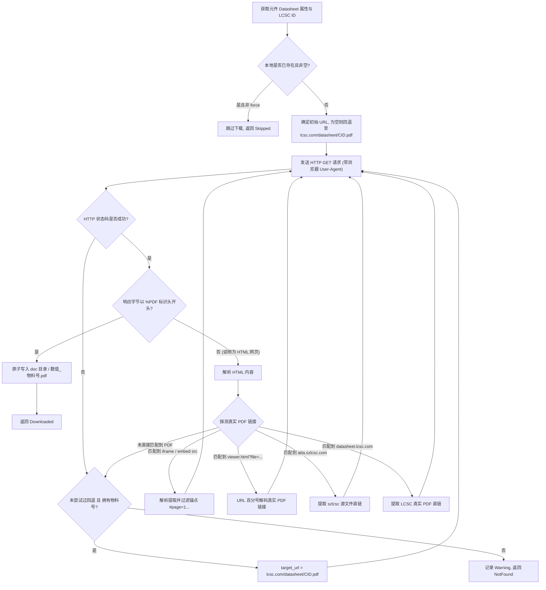

# SeEx 库下载程序新增功能实现原理

本文档详细记录 `seex` 针对嘉立创（JLC/LCSC）元器件库导出程序新增的三项核心功能的实现原理、架构设计、代码改动及编译运行方法。

---

## 目录
1. [功能一：同封装及其 3D 模型去后缀原生导出](#功能一同封装及其-3d-模型去后缀原生导出)
   - [1.1 需求背景](#11-需求背景)
   - [1.2 命名还原算法与规格转换](#12-命名还原算法与规格转换)
   - [1.3 封装导出处理流程（Footprint Converter）](#13-封装导出处理流程footprint-converter)
   - [1.4 3D STEP 模型导出处理（Model Converter）](#14-3d-step-模型导出处理model-converter)
2. [功能二：符号库“数据手册”PDF 本地自动化下载](#功能二符号库数据手册pdf-本地自动化下载)
   - [2.1 需求背景与文件组织](#21-需求背景与文件组织)
   - [2.2 多层级链接解析与探测链路（Resolution Pipeline）](#22-多层级链接解析与探测链路resolution-pipeline)
   - [2.3 防错与真实性校验机制](#23-防错与真实性校验机制)
   - [2.4 网络客户端与并发优化](#24-网络客户端与并发优化)
3. [功能三：GUI 导出设置选项增强（PDF / 物料后缀 / 小数点转换）](#功能三gui-导出设置选项增强pdf--物料后缀--小数点转换)
   - [3.1 需求背景与控制选项](#31-需求背景与控制选项)
   - [3.2 详细选项机制与行为规范](#32-详细选项机制与行为规范)
   - [3.3 配置自动持久化（ExportConfig）](#33-配置自动持久化exportconfig)
4. [功能四：STEP 3D 模型全标记清理与板级装配体容错](#功能四step-3d-模型全标记清理与板级装配体容错)
   - [4.1 需求背景与板级装配体失效根因](#41-需求背景与板级装配体失效根因)
   - [4.2 韧性分簇与逐簇提交机制](#42-韧性分簇与逐簇提交机制)
   - [4.3 标记候选特征过滤与微小符号覆盖](#43-标记候选特征过滤与微小符号覆盖)
   - [4.4 Pin 1 极性圆点保护](#44-pin-1-极性圆点保护)
5. [整体代码架构与改动清单](#整体代码架构与改动清单)
6. [编译与运行方法](#编译与运行方法)
   - [6.1 环境准备](#61-环境准备)
   - [6.2 测试与验证命令](#62-测试与验证命令)
   - [6.3 编译发布版本](#63-编译发布版本)
   - [6.4 运行与使用方法（CLI / GUI）](#64-运行与使用方法cli--gui)
7. [测试用例与验证覆盖](#测试用例与验证覆盖)

---

## 功能一：同封装及其 3D 模型去后缀原生导出

### 1.1 需求背景
嘉立创网络 API 导出的封装和 3D 模型文件名默认带有 `_C<id>` 物料编号后缀（例如 `XT30PW-M_C431092.kicad_mod` 和 `CONN-TH_XT30PW-M_C431092.step`）。
在实际硬件工程中，同一种标准封装（如 `XT30PW-M`、`0603` 阻容）应复用同一份无物料后缀的干净封装和 3D 模型，避免库中冗余堆积大量带特定批次物料号的重复模型。
此前该功能由独立的 Python 脚本（`restore_step_models.py`）后处理完成，现已原生内置于 `seex` 的 KiCad 导出管线中。

### 1.2 命名还原算法与规格转换
核心算法实现在 [`seex/src/kicad/converter.rs`](seex/src/kicad/converter.rs) 中：

1. **物料编号后缀剥离**：
   - 匹配尾部的 `_C\d+$`（忽略大小写）并剥离。
   - 示例：`XT30PW-M_C431092` $\rightarrow$ `XT30PW-M`。
2. **尺寸规格下划线恢复小数点**：
   - EDA 上游命名常将小数点替换为下划线（例如 `L1_6-W0_8-H0_8` 实为 `L1.6-W0.8-H0.8`）。
   - 通过正则匹配前后均为数字的下划线：`(\d)_(\d)`，替换为 `${1}.${2}`。
   - 示例：`C0603_L1_6-W0_8-H0_8_C999` $\rightarrow$ `C0603_L1.6-W0.8-H0.8`。
3. **3D STEP 模型命名对应**：
   - 保留 3D 模型的功能分类前缀（如 `CONN-TH_`、`RES-SMD_`），只对型号核心与后缀部分做相同剥离，得到与干净封装匹配的 `CONN-TH_XT30PW-M.step`。

### 1.3 封装导出处理流程（Footprint Converter）
实现于 [`seex/src/kicad/footprint_converter.rs`](seex/src/kicad/footprint_converter.rs)：

```
API 获取原始封装数据
        │
        ├─► 1. 导出带物料后缀的原始封装: {Name}_{C_ID}.kicad_mod
        │      (内部 3D 模型指向: {Model}_{C_ID}.step)
        │
        └─► 2. 生成并导出无后缀干净封装: {Clean_Name}.kicad_mod
               ├─ 替换内部 S 表达式 footprint 名称为 Clean_Name
               ├─ 替换 value 文本字段为 Clean_Name
               ├─ 替换内部 3D 模型引用路径为 Clean_Model.step
               └─ 使用 write_footprint_if_needed(overwrite: false)
                  (若同名干净封装已存在，直接安全跳过，确保只保存一次)
```

- **S 表达式转换保证**：
  使用精确正则匹配封装头 `(footprint "{old_name}")` 和值字段 `(property "Value" "{old_name}" ...)` 进行原地替换，保证导出的 KiCad v6 封装语法合规。
- **唯一性与防重复覆盖**：
  设置 `overwrite: false`，同一工程中即使导入 10 颗不同物料但封装同为 `0603` 的阻容，无后缀的 `0603.kicad_mod` 仅在首次生成时写入磁盘，后续批次自动复用。

### 1.4 3D STEP 模型导出处理（Model Converter）
实现于 [`seex/src/kicad/model_converter.rs`](seex/src/kicad/model_converter.rs)：

1. API 下载 STEP 模型字节流并经由 `step_sanitizer` 去除杂乱丝印/覆盖层。
2. 写入原始带后缀模型文件：`<lib_name>.3dshapes/{model_name}.step`。
3. 计算还原出的无后缀文件名 `clean_model_name`。
4. 若 `clean_model_name != model_name` 且本地尚未存在该 clean 模型文件：
   - 直接复用内存中已过滤好的模型二进制数据写入磁盘；
   - 记录 `clean_model_name` 已写入状态，避免后续物料重复 IO 写入。

---

## 功能二：符号库“数据手册”PDF 本地自动化下载

### 2.1 需求背景与文件组织
符号库 `murmur.kicad_sym` 中的每一个元器件符号均包含 `(property "Datasheet" "...")` 属性。
为方便离线查阅与库归档，系统自动将数据手册真实 PDF 文件下载到本地专门的数据手册库目录：
- **目录规范**：`<output_path>/<lib_name>.doc/`（例如 `murmur.doc/`），与 `<lib_name>.pretty/`、`<lib_name>.3dshapes/` 及 `<lib_name>.kicad_sym` 保持完全平级。
- **命名规范**：`“数值”+“物料号”.pdf`，即 `{Value}_{C_ID}.pdf`（例如 `DON70N03_C48542676.pdf`、`1N4148W-TP_C77978.pdf`），与符号库内符号对象名 `(symbol "DON70N03_C48542676" ...)` **完全一致**。

### 2.2 多层级链接解析与探测链路（Resolution Pipeline）
上游返回的数据手册链接形式多样，实现模块 [`seex/src/kicad/datasheet.rs`](seex/src/kicad/datasheet.rs) 构建了多跳探测引擎（最多 4 次自动重定向与 DOM 内嵌解析）：



#### 各类型链接解析策略：
1. **直接 PDF 链接**：
   - 如 `https://example.com/datasheet.pdf`。
   - 读取前 4 字节魔数判定是否为 `b"%PDF"`，确认直接写入。
2. **嘉立创官方预览器（szlcsc Viewer）**：
   - 典型 URL：`https://item.szlcsc.com/datasheet/DON70N03/50802276.html`。
   - 特征：响应为 HTML，内嵌 `<iframe src="https://atta.szlcsc.com/upload/public/pdf/source/xxx.pdf#page=1&view=fitH">`。
   - 处理：正则提取 `src` 并剥离 `#...` 片段锚点，下一跳请求真实 PDF 直链。
3. **PDF.js Web 预览器参数**：
   - 特征：`<iframe src="/pdfjs/web/viewer.html?file=https%3A%2F%2Fatta.szlcsc.com%2F...pdf">`。
   - 处理：解析查询参数 `file`，执行自实现的 `percent_decode` 还原为标准 URL。
4. **立创商城产品详情页（Product Detail Page）**：
   - 典型 URL：`https://www.lcsc.com/product-detail/Switching-Diode_MCC_1N4148W-TP_1N4148W-TP_C77978.html`。
   - 特征：HTML 包含指向 `https://www.lcsc.com/datasheet/C77978.pdf` 或 `https://datasheet.lcsc.com/...` 的下载锚点。
   - 处理：提取并追踪链接。
5. **立创商城手册嵌入页（LCSC Datasheet Page）**：
   - 典型 URL：`https://www.lcsc.com/datasheet/C77978.pdf`（扩展名为 `.pdf`，但实为封装了 iframe 的 HTML 网页）。
   - 特征：HTML 内包含 `<iframe src="https://datasheet.lcsc.com/datasheet/pdf/<hash>.pdf?productCode=C77978">`。
   - 处理：多跳循环第二跳解析出该 iframe 地址，第三跳请求获得真正的 `%PDF` 二进制流。

### 2.3 防错与真实性校验机制
- **`%PDF` 魔数强制校验**：
  任何下载的响应数据在落盘前必须检查 `bytes.starts_with(b"%PDF")`。严防将 HTML 404 页面或防爬验证页保存为 `.pdf` 损坏文件。
- **原子安全写入（Atomic Write）**：
  先写入临时文件 `.tmp`，刷写完成后原子重命名为正式 `.pdf` 文件，防止下载中断产生坏损残卷。
- **故障隔离设计**：
  当某个元器件因停产/下架导致官方无可用数据手册时，仅通过 `log::warn!` 输出提示信息，不阻断、不影响 KiCad 原理图符号与封装库的正常导出。

### 2.4 网络客户端与并发优化
- **专用浏览器标识**：
  `datasheet_client()` 全局单例持有配置了标准 Chrome 120 浏览器 User-Agent 的 `reqwest::Client`，规避立创/阿里 CDN WAF 对脚本默认 User-Agent 的拦截。
- **连接池复用**：
  支持多元件批量并发导出时复用长连接（Keep-Alive），大幅缩短批量抓取耗时。

---

## 功能三：GUI 导出设置选项增强（PDF / 物料后缀 / 小数点转换）

### 3.1 需求背景与控制选项
为满足不同硬件工程团队对元件库规范的个性化需求（例如：部分用户无需离线数据手册以节约磁盘与带宽；部分用户不需要在库文件名中携带特定批次物料编号；部分用户或 EDA/CAM 工具要求尺寸规格中的小数点全部替换为下划线以防解析异常），在 GUI 界面的 **Export Settings（导出设置）** 面板中新增了 3 项交互切换开关（Toggle Button），并支持随软件自动持久化保存：

- **下载PDF (`Download PDF`)**：控制是否下载数据手册 PDF 文件；
- **添加物料后缀 (`Add Suffix`)**：控制是否为导出的库文件添加 `_C<id>` 物料编号后缀；
- **替换小数点.为下划线_ (`Replace . with _`)**：控制尺寸数值与命名中小数点 `.` 到下划线 `_` 的替换转换；
- **封装保留 (`Preserve Package`)**：控制是否额外以页面商品封装为基底（如 `SOT-223`）导出封装文件。

### 3.2 详细选项机制与行为规范

| 选项名称 (中/英) | 默认值 | 启用状态行为 (True) | 关闭状态行为 (False) | 影响管线范围 |
|---|---|---|---|---|
| **下载PDF**<br>`Download PDF` | `true` | 在符号库导出阶段，自动探测并下载对应元器件真实 `%PDF` 数据手册至 `<lib_name>.doc/` 目录 | 完全跳过 PDF 探测与网络下载，不创建冗余 `.doc` 目录，大幅加速批量导出耗时 | KiCad Workflow、数据手册下载管线 |
| **添加物料后缀**<br>`Add part suffix` | `true` | 导出的封装、3D 模型、原理图符号与数据手册均携带立创物料后缀（如 `XT30PW-M_C431092`），同时辅助生成干净无后缀模型 | **仅生成无后缀的干净封装与 3D 模型**（如 `XT30PW-M.kicad_mod` 和 `CONN-TH_XT30PW-M.step`）；符号名称与 `Footprint` 属性直接绑定干净封装名，避免库文件冗余 | Footprint、Model、Symbol、Datasheet 命名与导出 |
| **替换小数点.为下划线_**<br>`Replace . with _` | `false` | 将元器件命名与尺寸中的小数点 `.` 转换为下划线 `_`（例如 `L1.6-W0.8` $\rightarrow$ `L1_6-W0_8`、`2.54mm` $\rightarrow$ `2_54mm`），适应特殊 CAD/CAM 语法要求 | **保留标准小数点 `.`**，并将上游 EDA 导出的尺寸数字间下划线智能还原为标准小数点（例如 `L1_6-W0_8` $\rightarrow$ `L1.6-W0.8`） | 命名清洗还原算法、封装与 3D 模型命名 |
| **封装保留**<br>`Preserve Package` | `false` | 额外添加以**页面商品封装**为基底命名的封装文件与 3D STEP 模型文件（例如 `C6186` 商品封装为 `SOT-223`）：<br>• 未开启后缀：保存为 `SOT-223.kicad_mod` 与 `SOT-223.step`<br>• 开启后缀：保存为 `SOT-223_C6186.kicad_mod` 与 `SOT-223_C6186.step`（并保留干净 `SOT-223.kicad_mod` 与 `SOT-223.step`）<br>• 开启替换：保存为 `SOT-223.C6186.kicad_mod` 与 `SOT-223.C6186.step`（并保留干净 `SOT-223.kicad_mod` 与 `SOT-223.step`）<br>且封装内部 3D 模型关联路径与封装文件名严格一致。<br><br>*(注：对贴片阻容感等 `\d{4}` 封装如 `0805`、`0603`、`0402`，电阻与电容焊盘规格不同，系统严格保留 `R`、`C`、`L` 类别前缀，如 `R0805`、`C0805`、`R0603`，生成 `R0805.kicad_mod`、`R0805.step`、`R0805_C3013955.kicad_mod`、`R0805_C3013955.step` 等，避免阻容封装相互覆盖)* | 仅导出以商品名称为基底的封装与 3D 模型（如 `AMS1117-3.3.kicad_mod`） | Footprint 与 Model 3D 导出管线、命名生成器 |

### 3.3 配置自动持久化（ExportConfig）
- 界面操作变动实时通过 `MonitorState` 的 `set_export_download_pdf()`、`set_export_add_suffix()`、`set_export_replace_dot()` 和 `set_export_preserve_package()` 进行响应。
- 配置变更即时触发 `save_config()` 自动持久化写入操作系统用户目录下的 `export_config.json`（带有 `#[serde(default)]` 机制，保证升级向后兼容）。
- 软件重启后无缝加载恢复历史设置。

---

## 功能四：STEP 3D 模型全标记清理与板级装配体容错

### 4.1 需求背景与板级装配体失效根因
此前版本新增了“去除所有类似特征的 logo 或文字丝印标记”（`AllMarkings` 模式，用于清理诸如 SOT-223/SOT-8 封装型号信息、字母代号、图形商标等），并保护 Pin 1 极性圆点。
在单器件模型（如 `sot-223-4p.step`）测试中表现正常，但在多 STEP 装配的复杂 PCB 板级工程中出现严重失效：**连原有的 EasyEDA logo 都未能去除，日志提示 `⚠ 检测到标记但流形/极点保护保留`，最终整个板级模型无任何改变**。

#### 深度根因排查：
1. **整板单批次“全有或全无”回滚机制**：
   在旧版 `AllMarkings` 逻辑中，整板检测出的所有候选标记（涵盖各器件型号与可能误判的结构）被一次性全量交给 `model.delete_cascading(dead)`。
   若整板多达上百个实体中存在**任意一个标记特征**由于与 PCB 阻焊层/大铜皮共面等原因破坏了闭合壳体（`model.is_consistent() == false`），算法即判定整体失败并触发整板回滚（`Err(LogoOutcome::Kept)`），从而将本可 100% 干净移除的 EasyEDA 厂商 logo 及其他绝大多数正常元器件标记一同强行回滚保留。
2. **候选特征缺乏尺度约束导致误报**：
   原选择器仅排除了 Pin 1 圆点，但未对几何尺寸施加面积与长宽限制。复杂板级装配体中的安装螺丝孔边缘、SMD 焊盘外轮廓、开窗铜皮极易被当作浮雕/标记候选纳入。
3. **全局共面过度聚合**：
   原标记聚类仅根据平面法向（如 `[0, 0, 1]`）与 Z 轴偏移判定共面，导致整块 PCB 顶层所有不同器件的标记被错误合并为一个跨越整板的超大组，放大边界污染。
4. **极小微文字符号阈值边界遗漏**：
   连字符 `-`（如 `SOT-223-4P` 中的两个 `-`）最大投影尺寸仅为 `0.132 mm`，原尺寸硬阈值 `max_dim < 0.15 mm` 导致连字符被跳过。

### 4.2 韧性分簇与逐簇提交机制（Resilient Per-Cluster Removal）
在 [`seex/src/step_logo.rs`](seex/src/step_logo.rs) 中重构了 `AllMarkings` 处理流程：

1. **EasyEDA / LCEDA 厂商 Logo 优先无条件剥离**：
   优先通过成熟的几何指纹特征定位 EasyEDA 厂商图标与行文字并先行移除，保证厂商水印在任何情况下均能优先干净剔除。
2. **基于基底面（Base Face）与局部空间距离的高精度分簇**：
   标记候选按所属的基础贴合面（`same_base_face`）和局部欧氏距离聚合为相互隔离的小簇（Cluster），避免跨器件、跨板面的全局污染。
3. **两阶段执行与韧性降级保护**：
   - **快速路径**：首先尝试对所有候选簇执行一键全量移除，若整板通过流形闭合校验（`model.is_consistent()`），则直接一次性提交；
   - **逐簇试探回退路径**：若整板全量移除未通过闭合校验，自动降级为安全探针模式——对每个簇逐个在克隆试探模型上进行独立修改与 `is_consistent` 拓扑检验。通过流形闭合的簇立即持久化提交生效，仅将极少数引起非流形拓扑破损的边缘结构安全跳过。彻底根除了“单个异常特征导致整板回滚”的问题。

### 4.3 标记候选特征过滤与微小符号覆盖
完善 `is_marking_candidate` 几何过滤器：
- **微小符号与大尺度机械结构过滤**：单体特征最大投影尺寸范围限定为 `0.08 mm ~ 12.0 mm`，既能完整覆盖微小连字符 `-`（`0.132 mm`）、小数点等，又严格过滤掉大面积机械外壳与板体。
- **薄片实体（Thin Solid）面积保护**：投影尺寸上限 `10.0 mm`，且投影面积不超过 `60.0 mm²`，严防误删 PCB 接地敷铜块。
- **浮雕特征（Relief Loops）拓扑过滤**：凹刻/浮雕深度不得超过上限，且基础面必须至少具备外环边界与内环浮雕边界（`face_bounds.len() >= 2`），排除单环基底。

### 4.4 Pin 1 极性圆点保护与单模型作用域简化
- 在标记识别前对所有凹刻圆形和独立微小凸点特征执行 `is_pin_one_mark` 保护：结合圆形度、横纵比（接近 1:1）、特征面积与邻域隔离度，判定为 Pin 1 极性定位圆点的特征一律施加最高优先级豁免，防止元器件方向标识被误清。
- 经实测发现，在包含数百个元器件的超大规模整板级 PCB 装配体中，由于各种阻焊微孔、测试点及焊盘形状多样，全板级文字特征与极性标记在全局逻辑上难以完全无损兼顾。
- **双场景协同与作用域提示**：
  1. **3D Tools 页面提供全标记模式与复合体提示**：3D 去标工具提供 `仅 EasyEDA Logo` 与 `所有标记与丝印` 两档选项。当用户选中 `所有标记与丝印` 时，界面以醒目的告警样式实时提示：*“⚠ 提示：对多个 STEP 组成的复合体（板级装配体）无效；建议仅用于单器件模型以保证几何准确性（保留 Pin 1 极性点）”*。
  2. **Export 导出选项卡新增“去除所有标记 (增强)”开关**：在导出设置中作为“去除 3D 标志”的子增强选项提供。由于嘉立创库导出阶段严格针对**单个元器件 3D 模型**（如 SOT-223、SOP-8、QFN）逐个下载并处理，单模型几何拓扑清晰纯粹，能够 100% 确保在清除封装型号文字的同时完美保留 Pin 1 极性标记，彻底避免复杂板级装配体的冲突隐患。

---

## 整体代码架构与改动清单

| 模块文件 | 关键职责与修改 |
|---|---|
| [`seex/src/step_model.rs`](seex/src/step_model.rs) | `ModelCleanup` 增加 `clean_all_markings` 选项，单器件模型导出时支持无缝无损去除文字标记并保留 Pin 1 极性 |
| [`seex/src/step_logo.rs`](seex/src/step_logo.rs) | **【重构增强】** 重写 `AllMarkings` 模式下的 `remove_logo_with_mode`，实现 EasyEDA logo 优先剔除、局部基底面聚类、韧性逐簇提交（Resilient Cluster Trial）、`is_marking_candidate` 尺度过滤及 Pin 1 圆点保护机制 |
| [`seex/src/step_cleaner.rs`](seex/src/step_cleaner.rs) | STEP 模型清洗管道适配 `LogoOnly` 与 `AllMarkings` 模式分发及多线程批量清洗统计 |
| [`seex/src/main.rs`](seex/src/main.rs) | GUI Export Settings 面板增加“下载PDF”、“添加物料后缀”、“替换小数点.为下划线_”、“封装保留”、“去除所有标记”四大开关，处理配置加载与快照持久化 |
| [`seex/src/config.rs`](seex/src/config.rs) | `ExportConfig` 结构体新增 `clean_all_markings`、`download_pdf`、`add_suffix`、`replace_dot`、`preserve_package` 字段及默认值定义 |
| [`seex/src/monitor.rs`](seex/src/monitor.rs) | `MonitorState` 增加 `export_clean_all_markings` 状态字段及 setter 方法 |
| [`seex/src/exporter.rs`](seex/src/exporter.rs) | `ExportRequest` 传递 `clean_all_markings` 选项并在后台线程正确配置 `ModelCleanup` |
| [`seex/src/ui/pages/export.rs`](seex/src/ui/pages/export.rs) | 导出页面新增 `toggle-clean-all-markings` 增强开关与联动逻辑 |
| [`seex/src/ui/pages/step_clean.rs`](seex/src/ui/pages/step_clean.rs) | 3D 去标工具增加“所有标记与丝印”选项，并包含针对多 STEP 复合板级装配体无效的醒目提示 |
| [`seex/src/kicad/converter.rs`](seex/src/kicad/converter.rs) | `sanitize_name`、`restore_footprint_name`、`restore_step_model_name` 支持 `replace_dot` 切换；新增 `extract_package_base`、`resolve_package_name`、`make_package_suffixed_name` 命名构造与提取器 |
| [`seex/src/kicad/footprint_converter.rs`](seex/src/kicad/footprint_converter.rs) | 封装导出及 3D 模型引用路径适配 `add_suffix` 与 `replace_dot`；支持 `preserve_package` 封装保留选项导出标准封装命名文件 |
| [`seex/src/kicad/model_converter.rs`](seex/src/kicad/model_converter.rs) | 3D STEP 模型导出适配 `add_suffix` 与 `replace_dot`；当 `add_suffix: false` 时仅输出标准命名 STEP 模型，节约下载流量 |
| [`seex/src/kicad/symbol_converter.rs`](seex/src/kicad/symbol_converter.rs) | 原理图符号名称与 `Footprint` 属性绑定根据 `add_suffix` 自动对齐带后缀或干净封装名称 |
| [`seex/src/kicad/datasheet.rs`](seex/src/kicad/datasheet.rs) | **【新增模块】** 数据手册探测引擎、iframe 解析、百分号解码、`%PDF` 校验及下载管线 |
| [`seex/src/kicad/library.rs`](seex/src/kicad/library.rs) | `LibraryManager` 增加 `doc_lib_dir` 目录管理（`<lib_name>.doc`）、`get_doc_path` 与 `write_doc_file` 原子写 |
| [`seex/src/kicad/workflow.rs`](seex/src/kicad/workflow.rs) | KiCad 批量导出管线整合：解析商品属性补充 `supplier_footprint`，根据各开关决定抓取与封装保留逻辑 |
| [`seex/src/kicad/options.rs`](seex/src/kicad/options.rs) | `KicadExportOptions` 新增 `download_pdf`、`add_suffix`、`replace_dot`、`preserve_package` 字段与默认值实现；`KicadLibraryOptions` 新增 `doc_lib` |
| [`seex/src/cli.rs`](seex/src/cli.rs) | `KicadCommands::Export` 与 `Batch` 增加 `--doc-lib` 选项支持 |
| [`seex/src/exporter.rs`](seex/src/exporter.rs) | `ExportRequest` 传递新选项，GUI 导出汇总信息展示新增 `Datasheets` 计数与配置状态展示 |

---

## 编译与运行方法

### 6.1 环境准备
- **Rust 工具链**：支持 Rust 2024 edition（建议使用最新 stable 或 nightly 版本）。
- 确认命令可用：
  ```bash
  rustc --version
  cargo --version
  ```

### 5.2 测试与验证命令
进入 `seex` 源代码目录执行测试：
```bash
cd seex

# 1. 运行语法检查与代码分析
cargo check

# 2. 运行完整测试套件（共 139 个测试用例，包含单元测试与网络端到端测试）
cargo test --bin seex

# 3. 运行特定模块测试：
# 仅测试数据手册下载与链接探测引擎
cargo test --bin seex kicad::datasheet::tests

# 仅测试封装与 3D 模型去后缀还原
cargo test --bin seex kicad::converter::tests

# 仅测试 KiCad 全流程批量导出
cargo test --bin seex kicad::workflow::tests::test_export_kicad_batch_with_datasheet_and_clean_names
```

### 5.3 编译发布版本

#### 方式一：一键脚本编译（推荐）
直接双击运行根目录或 `seex/` 目录下的 `build.bat` 脚本，脚本将自动检测 Rust 工具链完成优化编译，并支持编译完成后一键启动：
```bash
build.bat
```

#### 方式二：命令行手动编译
编译优化并去除调试符号的 Release 二进制可执行文件：
```bash
cd seex
cargo build --release --bin seex
```
编译产物位于：
- **Windows**：`seex/target/release/seex.exe`

### 5.4 运行与使用方法（CLI / GUI）

#### A. 命令行方式（CLI）
通过命令行可以直接单颗或批量抓取下载：

1. **单颗元件导出**（以 DON70N03 / C48542676 为例）：
   ```bash
   cd seex
   cargo run --release --bin seex -- kicad export C48542676 --full -o ../export --library-name murmur
   ```
   或者直接运行编译好的可执行程序：
   ```bash
   ./target/release/seex.exe kicad export C48542676 --full -o ../export --library-name murmur
   ```

2. **批量元件导出**（从包含物料号的文本文件读取）：
   ```bash
   ./target/release/seex.exe kicad batch -i ids.txt --full -o ../export --library-name murmur --parallel 4
   ```

3. **导出后生成的标准目录结构**：
   ```
   export/
   ├── murmur.kicad_sym                # 符号库文件（包含原理图符号及数据手册元数据）
   ├── murmur.pretty/                  # 封装库目录
   │   ├── DON70N03_C48542676.kicad_mod # 原始带物料号封装
   │   └── TO-252-2.kicad_mod          # 原生去后缀干净封装（复用且仅保存一次）
   ├── murmur.3dshapes/                # 3D 模型目录
   │   ├── TO-252-2_C48542676.step     # 原始带物料号 3D 模型
   │   └── TO-252-2.step               # 原生去后缀干净 3D 模型（复用且仅保存一次）
   └── murmur.doc/                     # 数据手册 PDF 目录
       └── DON70N03_C48542676.pdf      # 自动下载的 PDF 手册（以“数值_物料号”命名）
   ```

#### B. 桌面图形界面方式（GUI）
直接双击运行 `seex.exe` 或运行 `cargo run --release --bin seex`：
1. 顶部切换到 **“导出”**（Export）页面；
2. **EDA 目标** 选择 **KiCad**；
3. **导出目标** 选择 **Full**（同时导出符号、封装与 3D 模型）；
4. **Export Settings（导出设置）** 面板中根据需求切换新功能选项：
   - **下载PDF (`Download PDF`)**：按需开启/关闭手册抓取；
   - **添加物料后缀 (`Add part suffix`)**：按需开启/关闭 `_C<id>` 后缀；
   - **替换小数点.为下划线_ (`Replace . with _`)**：按需开启/关闭命名中 `.` 到 `_` 的替换转换；
   - *（所有选项均自动即时保存至配置文件，下次启动保持记忆）*；
5. 点击 **“导出库”**；
6. 系统将依据设置导出符号、封装与 3D 模型，并在指定输出路径下下载数据手册 PDF 到本地。

---

## 测试用例与验证覆盖

所有功能均在 Rust 本地单元测试与真实网络测试中完成双重验证（测试全部通过：`139 passed, 0 failed`）：

```
running 139 tests
test kicad::converter::tests::test_restore_footprint_name ... ok
test kicad::converter::tests::test_restore_step_model_name ... ok
test kicad::converter::tests::test_replace_dot_with_underscore ... ok
test kicad::footprint_converter::tests::test_convert_footprint_exports_both_suffixed_and_clean ... ok
test kicad::footprint_converter::tests::test_convert_footprint_exports_clean_only_when_no_suffix ... ok
test kicad::datasheet::tests::test_percent_decode ... ok
test kicad::datasheet::tests::test_extract_szlcsc_iframe ... ok
test kicad::datasheet::tests::test_extract_viewer_file_param ... ok
test kicad::datasheet::tests::test_extract_lcsc_iframe ... ok
test kicad::datasheet::tests::test_extract_lcsc_product_detail ... ok
test kicad::datasheet::tests::test_live_download_szlcsc_datasheet ... ok
test kicad::datasheet::tests::test_live_download_lcsc_product_detail ... ok
test kicad::workflow::tests::test_export_kicad_batch_with_datasheet_and_clean_names ... ok
test kicad::workflow::tests::test_export_kicad_batch_without_datasheet ... ok
test kicad::workflow::tests::test_export_kicad_batch_without_suffix ... ok
...
test result: ok. 139 passed; 0 failed; 0 ignored; 0 measured; 0 filtered out; finished in 4.29s
```

### 重点验证场景：
1. **命名转换验证**：针对标准封装、连接器前缀、尺寸带小数下划线以及 `replace_dot` 切换等复杂命名的正向与边界测试。
2. **去重与去后缀写入验证**：
   - 验证在 `add_suffix: true` 下生成双份模型并正确关联；
   - 验证在 `add_suffix: false` 下仅生成无物料后缀的标准封装与 3D 模型，且原理图符号属性自动正确对齐干净封装名。
3. **数据手册下载开关验证**：
   - 验证在 `download_pdf: false` 下全流程跳过 PDF 探测与下载，本地不生成多余的 `.doc` 文件；
   - 验证在 `download_pdf: true` 下多跳追踪并原子落盘标准格式 `%PDF`。
4. **真实元件 live 联网下载验证**：
   - 验证 `DON70N03`（`C48542676`）成功解析 szlcsc 预览页 iframe 并下载 `DON70N03_C48542676.pdf`。
   - 验证 `1N4148W-TP`（`C77978`）成功从产品详情页多跳追踪下载 `1N4148W-TP_C77978.pdf`。
   - 二次下载执行，验证 `force: false` 时毫秒级跳过缓存文件。
5. **端到端批处理验证**：通过 `export_kicad_batch` 执行全流程，检验 `.kicad_sym`、`.pretty`、`.3dshapes` 与 `.doc` 四者同步导出及不同配置选项组合的一致性。

---

## 功能五：内置嵌入式 Web 服务器与浏览器全功能支持（Docker / 云端部署）

### 8.1 需求背景与架构设计
为了让 `seex` 能够脱离桌面图形界面的限制，直接部署在远程服务器（Linux VPS、云主机、局域网构建服务器、Docker 容器）中并由研发人员通过网页浏览器跨平台访问，系统深度集成了基于 `Axum` + `Tokio` + `Tower` 的高性能异步 Web 引擎与流式归档管线。

#### 核心技术特性：
1. **单一二进制完整自包含（Zero-Dependency Embedded SPA）**：
   - 现代化的单页面 Web 应用（HTML5/CSS3/ES6+ 原生 JavaScript）在编译期通过 `include_str!` 完全内嵌在 `seex` 二进制程序中。
   - **零运行时外部依赖**：部署无需 Node.js、npm、Nginx 或分离的静态资源目录，单个编译产物随处拷贝即跑。
2. **桌面端与无头服务器自适应双模式（Headless Auto-Fallback）**：
   - **桌面环境（Windows / macOS / Linux X11/Wayland）**：直接运行 `seex` 默认拉起原生 GPUI 窗口界面；
   - **无头服务器环境（Headless Linux VPS / Docker）**：当系统未检测到 `$DISPLAY` 或 `$WAYLAND_DISPLAY` 环境变量时，自动无缝启动 Web 服务器（监听 `0.0.0.0:8080`），并在标准输出打印 Web 访问地址与 API 指南；
   - **CLI 命令行显式指定**：支持 `seex server` 或 `seex -s`（可配合 `--host`、`--port`、`--open`）随时启动 Web 服务。
3. **流式动态 ZIP 压缩下载**：
   - 浏览器端发起导出后，后端异步任务拉取元器件数据与 3D STEP 模型并落盘至临时目录，随后使用 `zip` 库通过 Deflate 压缩并直接通过 HTTP 附件流下发给浏览器，避免服务器残留冗余缓存。

### 8.2 核心 REST API 规范与端点说明
后端对外暴露符合 OpenAPI 规范的标准 REST API，并内建 CORS 跨域支持：

| HTTP 方法 | API 端点 | 说明 | 请求参数 / Body | 响应格式 |
| :--- | :--- | :--- | :--- | :--- |
| `GET` | `/` 或 `/index.html` | 嵌入式 Web 前端单页面应用 | 无 | `text/html; charset=utf-8` |
| `GET` | `/api/status` | 实例健康检查与运行时状态 | 无 | `{"status":"ok", "version":"3.0.0", "uptime_secs": ...}` |
| `GET` | `/api/search` | 实时检索嘉立创元器件数据库 | `?q=<keyword_or_id>` | 元器件概要数组 JSON（型号、厂商、封装、3D可用性） |
| `GET` | `/api/detail` | 获取单个元器件完整元数据 | `?id=<lcsc_id>` | 元件详情 JSON（符号、封装、数据手册直链、3D UUID） |
| `POST` | `/api/export` | 单件/批量导出并打包为 ZIP | JSON 请求体（见下） | `application/zip` 归档包流式下载 |
| `POST` | `/api/clean-step` | 3D STEP 模型在线去标去丝印 | `?mode=logo_only\|all_markings&filename=...`, Body: STEP 文件流 | `application/octet-stream` 清洗后 STEP 文件，响应头携带 `X-Removal-*` 统计数据 |

#### Export 请求 Body 格式示例：
```json
{
  "ids": ["C6186", "C2040"],
  "target": "kicad",
  "mode": "full",
  "library_name": "SeExExport",
  "download_pdf": true,
  "add_suffix": false,
  "replace_dot": false,
  "preserve_package": true,
  "remove_model_logo": true,
  "clean_all_markings": false,
  "lcsc_english": false
}
```

### 8.3 浏览器 Web 界面功能亮点
前端界面在设计上对齐现代化工业级仪表盘（Linear / Apple 极简美学）：
1. **暗黑/明亮自适应双色主题**：支持系统深浅色偏好检测，并在导航栏右上角提供无刷新一键切换（持久化至 `localStorage`）。
2. **搜索与导出主界面（Search & Export）**：
   - 实时根据立创编号（如 `C6186`）或关键词（如 `AMS1117`, `TYPE-C`）检索云端物料库；
   - 结果卡片展示厂商、封装、3D 模型可用状态，支持展开“元器件完整信息”模态窗查阅官方 PDF 数据手册直链；
   - 完整的导出控制面板：可自由开启/关闭“下载数据手册 PDF”、“保留立创封装”、“去除 3D 厂商 Logo”及“去除所有丝印”，点击“导出 ZIP”即时在浏览器中下载生成好的 EDA 库归档。
3. **BOM 智能批量导出（Batch Export）**：
   - 支持直接从 Excel、ERP 系统或原理图清单中整段复制混乱文本粘贴到输入框；
   - 前端通过正则表达式自动抓取并去重所有 `C\d+` 元件编号，实时更新识别徽标；
   - 点击“开始批量导出”，后端并发拉取与转换，前端显示进度条与控制台日志，完成后自动触发批量 ZIP 下载。
4. **3D STEP 去标工坊（3D Tools）**：
   - 拖拽或点击上传本地任意 `.step` 模型文件；
   - 提供双清洗模式切换：**仅去除嘉立创 Logo**（完全兼容复杂装配体）与**去除所有丝印与文字标记**（包含 Pin 1 极性保护，并显示装配体警示）；
   - 清洗完成后展示精确的移除标记处、碎片实体与几何拓扑面统计，并自动重命名保存为 `cleaned_<filename>` 下载。
5. **服务部署与开发指南选项卡（Deployment & API）**：
   - 页面内置 Docker 启动命令、Docker Compose 模板以及标准 curl 调用指令，便于开发者快速集成。

### 8.4 Docker 与服务器部署方法

#### 1. 使用 Docker 运行：
根目录已提供多阶段构建优化的 `Dockerfile` 与 `docker-compose.yml`：
```bash
# 方式 A：通过 Docker 构建并运行
docker build -t seex:latest .
docker run -d --name seex-server -p 8080:8080 --restart unless-stopped seex:latest

# 方式 B：通过 Docker Compose 一键启动
docker compose up -d
```

#### 2. 直接二进制运行（Linux / Windows / macOS Server）：
```bash
# 启动 Web 服务器并监听 8080 端口
seex server --host 0.0.0.0 --port 8080

# 简写形式（支持自动打开默认浏览器）
seex -s --open
```
在任何连通网络的电脑或手机浏览器打开 `http://<服务器IP>:8080` 即可开始使用。

---

## 功能六：纯浏览器端 WebAssembly（.wasm）独立 Release 输出

### 9.1 需求背景与技术架构
为了进一步脱离可执行文件（`.exe`）与后端服务器进程的运行限制，充分利用 Rust 对浏览器端标准字节码的编译支持，系统新增了纯前端 **WebAssembly（WASM）独立发布管线**（`seex-wasm`）。

#### 关键特性与优势：
1. **与桌面/服务端 `.exe` 完全解耦独立编译**：
   - 独立的子包 `seex-wasm` 仅包含纯算法逻辑（3D STEP 几何拓扑解析、Logo 丝印剥离、Pin 1 极性保护、EDA 命名转换与尺寸规格恢复），彻底剔除了 GPUI、DirectX、X11、Windows API 等原生操作系统图形依赖。
   - 目标架构为标准 `wasm32-unknown-unknown`，10 秒内即可完成高强度内联与体积优化（`-C opt-level=z`、`lto = fat`）。
2. **纯客户端 JIT 原生执行（100% Client-Side）**：
   - 所有的 3D STEP 复杂几何分析与清洗计算完全运行在浏览器当前的 JavaScript/V8/WebAssembly JIT 虚拟机中。
   - **零服务器流量消耗、零网络延迟、零文件上传**：GB 级 STEP 模型直接在本地内存完成清洗与修改，具备军工级隐私安全性，且支持断网离线运行。
3. **极简无缝的 JavaScript SDK 包装（`seex.js`）**：
   - 采用标准 ES Module 规范，封装了 WASM 内存指针申请（`alloc`）、内存释放（`dealloc`）与类型转换。
   - 对外直接暴露 Promise 友好的原生 JS 接口（`cleanStep`、`restoreFootprintName`、`restoreStepModelName`）。

### 9.2 独立产物分发结构（`dist/wasm/`）
执行 WebAssembly 发布编译后，所有浏览器所需文件整齐打包至独立的 `dist/wasm/` 目录：
```text
dist/wasm/
  ├─ seex_wasm.wasm  # Rust 编译的 WebAssembly 高性能核心字节码 (约 1MB)
  ├─ seex.js         # 面向现代浏览器的 JavaScript SDK 封装库
  ├─ index.html      # 开箱即用、自适应深浅色主题的纯前端单页面应用 (SPA)
  └─ README.md       # 本地运行与 CDN / 静态服务器托管部署指南
```

### 9.3 核心 WebAssembly 导出与 JS SDK 调用

```javascript
import { initSeex, cleanStep, restoreFootprintName } from './seex.js';

// 1. 初始化 WASM 实例
await initSeex('seex_wasm.wasm');

// 2. 浏览器端 100% 本地极速清洗 STEP 模型
const fileBuffer = await file.arrayBuffer();
const result = cleanStep(new Uint8Array(fileBuffer), {
    allMarkings: true // true: 去除所有丝印(带 Pin 1 极性保护); false: 仅去除嘉立创 Logo
});

console.log(`去标结果: 移除标记 ${result.logosRemoved} 处，拓扑面 ${result.facesRemoved} 个，耗时 ${result.durationMs} ms`);

// 3. 立即触发浏览器零拷贝下载
const blob = new Blob([result.cleanedBytes], { type: 'application/octet-stream' });
const downloadUrl = URL.createObjectURL(blob);
```

### 9.4 编译与分发命令

项目根目录下提供了多种快捷编译指令：

| 编译指令 | 产物输出路径 | 说明 |
| :--- | :--- | :--- |
| `build_wasm.bat` 或 `build.bat wasm` | `dist/wasm/` | **单独编译 WebAssembly 浏览器纯前端发布包**（与 exe 彻底独立） |
| `build.bat` 或 `build.bat exe` | `seex/target/release/seex.exe` | 编译原生 Windows 桌面 GUI / 后端 Web 服务可执行程序 |
| `build.bat all` | 同步生成上述两套产物 | 同时输出桌面/服务二进制与前端 WebAssembly 归档包 |

#### 静态托管与浏览器打开：
由于浏览器针对 WebAssembly `fetch` 请求实施了严格的同源策略，请使用任意静态 HTTP 服务打开（或直接上传至 GitHub Pages / Vercel / Nginx 静态站点）：
```bash
# 使用 Python 一键预览
python -m http.server 8000 --directory dist/wasm

# 或使用 Node.js npx
npx serve dist/wasm
```
在浏览器访问 `http://localhost:8000` 即可开始使用。


